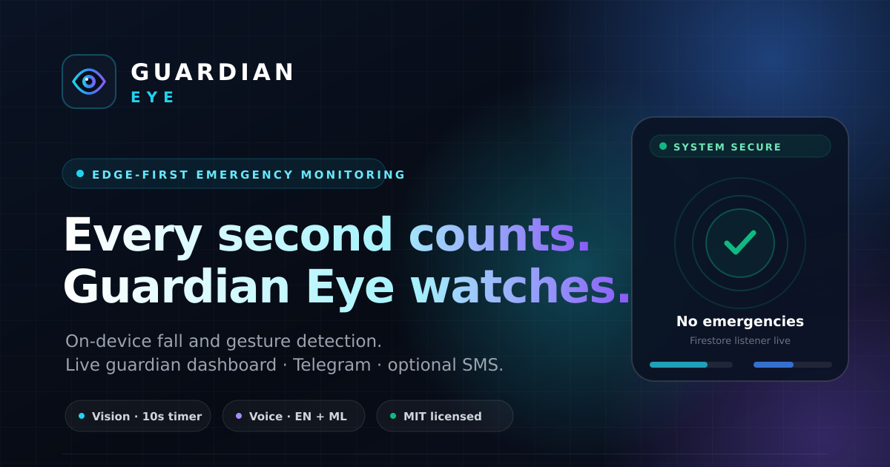

# GUARDIAN EYE

**Real-time multi-modal emergency detection for personal security and health monitoring.**

Guardian Eye watches over a person through a camera and a microphone at the same time. Fall detection, gesture recognition, and English keyword spotting run on-device (Raspberry Pi, laptop, or desktop); Malayalam recognition uses Google Speech when connectivity allows. Confirmed emergencies can reach Firebase, Telegram, and an optional GSM SMS module.

The repository also contains the Guardian Eye website: a public project site, an interactive decision-rule explorer, a read-only demo, and the authenticated guardian dashboard.



---

## 🧠 How it works

Guardian Eye combines three independent signal sources using timed rules, which keeps false positives low:

| Signal | Module | What it detects |
| --- | --- | --- |
| Vision | `fall_process.py`, `fall.py` | Falls via YOLOv8 pose keypoints, with furniture-aware suppression and optional Gemini verification |
| Gestures | `gesture.py` (inside `fall_process.py`) | Hands on chest, hands on head, raised hands, crossed arms |
| Audio | `voice_process.py` | Distress keywords in English (Vosk) and Malayalam (Google Speech) |

The **decision engine** (`decision_engine.py`) combines these streams using timed state-machine rules. The first matching rule wins:

| Condition | Alert reason |
| --- | --- |
| Fall persists for **≥ 10 seconds** | `Fall detected for ≥ 10 seconds` |
| Fall persists for **≥ 5 seconds** plus a voice keyword | `Fall ≥ 5 seconds + voice emergency keyword` |
| **3 voice keywords** within 20 seconds | `Voice emergency keyword repeated ≥ 3 times within 20 seconds` |
| Hand on chest for **≥ 10 seconds** | `Hand on chest detected for ≥ 10 seconds` |
| Hand on chest plus a voice keyword | `Hand on chest + voice emergency keyword` |

When an emergency is confirmed, Guardian Eye:

- writes the event to Firebase Firestore for the live dashboard,
- sends a Telegram message to emergency contacts,
- attempts a GSM SMS through a SIM800L module as an additional hardware channel.

The browser dashboard shows a full-screen alert while it is open. Guardian Eye does not use browser push notifications; Telegram and optional GSM SMS are the out-of-app channels.

---

## 🛠️ Architecture

### Edge engine

```
main.py                  Entry point; spawns vision + audio processes and runs the decision loop
├── fall_process.py      Camera pipeline + YOLOv8 inference + gesture evaluation + MJPEG stream
│   └── fall.py          Pose-based fall detector, furniture suppression, optional Gemini check
│   └── gesture.py       Keypoint-based gesture classification
├── voice_process.py     Continuous English/Malayalam keyword listener
├── decision_engine.py   Sensor fusion, timed rules, Firestore + Telegram alerts
├── gsm.py               SIM800L SMS path over serial
└── utils.py             Shared helpers
```

Python's `multiprocessing` keeps video inference and audio listening from blocking each other.

### Website

```
website/                 React 19 + Vite + Tailwind + Framer Motion + Firebase
├── src/pages/           Landing, auth, demo, dashboard, statistics, profile
├── src/components/      Shared dashboard UI, camera, emergency overlay, charts
├── src/demo/            Simulated incidents for /demo
├── firestore.rules      Browser access rules
└── vite.config.js       PWA manifest and service worker
```

The website is part of this repository and shares the Firestore schema used by the Python engine. It is not a separate project.

---

## 🚀 Installation

### Prerequisites

- Python 3.9+
- A webcam or Raspberry Pi Camera Module
- A microphone (for acoustic detection)
- Optional: SIM800L GSM module on `/dev/serial0`, Firebase project
- Node.js 20.19+ for the website

### 1. Clone the repository

```bash
git clone https://github.com/yedukrishna012/Guardian-Eye.git
cd Guardian-Eye
```

### 2. Install Python dependencies

A virtual environment is recommended:

```bash
python3 -m venv .venv
source .venv/bin/activate
pip install -r requirements.txt
```

On a Raspberry Pi, `requirements_pi.txt` contains a relaxed set of pins, and `setup_pi.sh` installs the required system libraries:

```bash
bash setup_pi.sh
```

### 3. Download the English speech model (optional)

Voice keyword detection uses [Vosk](https://alphacephei.com/vosk/). The model is not stored in the repository because of its size:

```bash
mkdir -p models
wget https://alphacephei.com/vosk/models/vosk-model-small-en-us-0.15.zip
unzip vosk-model-small-en-us-0.15.zip -d models
mv models/vosk-model-small-en-us-0.15 models/en
```

Without this model, Guardian Eye still runs the vision pipeline but skips English acoustic detection.

### 4. Configure Firebase (optional)

1. Open your Firebase project and generate an **Admin SDK private key**.
2. Save it in the project root as `service_account.json`.
3. Copy the device config template and fill in your Firebase user ID:

```bash
cp device_config.example.json device_config.json
```

```json
{
  "user_id": "YOUR_FIREBASE_UID_HERE",
  "gemini_api_key": ""
}
```

`service_account.json` and `device_config.json` are git-ignored and must never be committed. The optional `gemini_api_key` enables the Gemini vision second-opinion check.

### 5. Configure alerts (optional)

Copy the environment template and fill in your own values:

```bash
cp .env.example .env
```

```dotenv
TELEGRAM_BOT_TOKEN=your-bot-token
TELEGRAM_CHAT_IDS=123456789,987654321
GUARDIAN_EMERGENCY_PHONE=+919876543210
```

Alternatively, export the same variables in your shell. If they are unset, Telegram and GSM alerts are skipped with a warning while the rest of the system keeps running.

Camera stream protection is optional and unset by default:

```dotenv
# Require ?token=... on the MJPEG stream
CAMERA_STREAM_TOKEN=choose-a-long-random-value

# Restrict which browser origins may load the stream
CORS_ORIGINS=http://localhost:5173,http://192.168.1.20:5173
```

---

## 🏃 Running the edge engine

```bash
python main.py
```

Guardian Eye will:

1. Load the YOLOv8 pose model (`yolov8n-pose.pt`, included) and the object detector.
2. Open the camera feed (OpenCV on desktop, Picamera2/GStreamer on a Pi).
3. Start listening on the microphone.
4. Print live events to the terminal, serve the camera stream on port `5000`, and sync confirmed emergencies to the cloud.

The decision engine latches after the first confirmed emergency. Restart `main.py` to re-arm it.

---

## 🌐 Website and dashboard

The website lives in [`website/`](website/) and has its own detailed [README](website/README.md). It includes:

- **Public landing page** — interactive 3D hero, signal-fusion explorer, simulated dashboard preview, and PWA install prompt.
- **Decision Lab** — toggle simulated fall, voice, and gesture inputs and see which real rule confirms first.
- **Demo mode (`/demo`)** — a read-only dashboard with simulated incidents. No Firebase credentials or account are required.
- **Guardian dashboard** — Email/password authentication, realtime Firestore events, a full-screen emergency overlay, acknowledge/resolve, test alerts, and a local camera viewer.
- **Statistics** — date/status/search filters, activity chart, signal breakdown, CSV export, and pagination.
- **Profile** — pairing ID, account metadata, password reset, and sign-out.
- **PWA** — installable standalone app with reduced-motion support and accessible dialogs.

### Website quick start

```bash
cd website
npm ci
cp .env.example .env.local
# Fill in VITE_FIREBASE_* values from your Firebase web app
npm run dev
```

The public site and `/demo` work without Firebase. Account routes show a setup notice until every required `VITE_FIREBASE_*` value is present.

Deploy the Firestore rules after selecting your project:

```bash
cd website
npx firebase-tools deploy --only firestore:rules --project YOUR_PROJECT_ID
```

Then create an account at `/signup`, copy the pairing ID from `/profile`, and put it in `device_config.json` on the Pi.

### Website verification

```bash
cd website
npm run lint
npm run build
npm audit --omit=dev
```

See [`website/README.md`](website/README.md) for the Firebase schema, camera security, deployment notes, and troubleshooting.

---

## 📁 Repository layout

| Path | Purpose |
| --- | --- |
| `main.py` | Process orchestrator |
| `fall.py`, `fall_process.py` | Fall detection, gestures, and camera pipeline |
| `gesture.py`, `gesture_process.py` | Gesture math and an alternative standalone gesture process |
| `voice_process.py`, `voice_malayalam.py` | Voice keyword detection |
| `decision_engine.py` | Alert rules, Firestore sync, and Telegram dispatch |
| `gsm.py`, `telegram_alert.py` | Notification channels |
| `website/` | Public site, demo, guardian dashboard, and PWA |
| `Guardian_Eye_Documentation.md` / `.pdf` | Full technical documentation |
| `yolov8n-pose.pt` | Pose model used by the vision pipeline |
| `models/en/` | Vosk speech model (downloaded during setup, git-ignored) |
| `.env.example`, `device_config.example.json` | Configuration templates |
| `old.py`, `fall1.py`, `fall_backup.py` | Earlier development iterations, kept for reference |

---

## 🔐 Security notes

- No credentials are stored in this repository. Use `.env`, `device_config.json`, and `service_account.json`, all of which are git-ignored.
- Website Firebase values belong in `website/.env.local`; the template is `website/.env.example`. Vite variables are public in the browser bundle, so protect data with Authentication and Firestore rules rather than by hiding the API key.
- `website/firestore.rules` limits browser access to the signed-in guardian's own emergencies. The Python Admin SDK bypasses these rules by design.
- The camera stream is intended for a trusted LAN. If you set `CAMERA_STREAM_TOKEN`, the dashboard must use the same token. Do not expose port `5000` to the internet.
- An HTTPS dashboard cannot load an HTTP camera stream. Use LAN HTTP or an HTTPS reverse proxy/tunnel.
- If you previously used an older deployment, revoke any bot tokens that may have been exposed and rotate your credentials with [@BotFather](https://t.me/BotFather).

---

## 📄 Documentation

- [Guardian Eye technical documentation](Guardian_Eye_Documentation.md) / [PDF](Guardian_Eye_Documentation.pdf)
- [Website setup and security guide](website/README.md)

---

## 📜 License

Released under the MIT License. See [LICENSE](LICENSE) for details.

Copyright (c) 2026 Yedukrishna R (@yedukrishna012)

---

## 👥 Credits

Built as a college project by **Yedukrishna R**, **Jubin T Joseph**, **Muhammed Nabeel Sha A**, and **Rishijith Karthikeyan M**.

The web dashboard was originally contributed by **jubin217** and is credited in [NOTICE](NOTICE).
